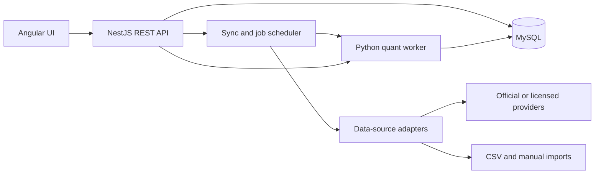

# Architecture

## Goals

The platform must support:

- Local-first research and portfolio monitoring.
- Indian listed-company discovery across NSE/BSE listings.
- Historical and current financial analysis.
- Auditable valuation assumptions and stock rankings.
- Point-in-time portfolio and backtesting calculations.
- Replaceable data-source providers.
- Manual imports and manual corrections.
- Clear data freshness and source attribution.

## Logical components

## Runtime components

### Angular frontend

The frontend provides:

- Company search and universe tables.
- Screener conditions and saved screens.
- Company statement and ownership pages.
- Editable valuation scenarios.
- Stock rankings and explanations.
- Portfolio and watchlist views.
- Dashboard, alerts, and backtesting controls.

UI components must render loading, stale-data, partial-data, and unavailable-data states explicitly. No number should imply a fact if its source or calculation provenance is unknown.

### NestJS API

The API owns:

- Domain validation.
- Authentication if enabled for the local application.
- REST endpoints.
- Import orchestration.
- Job scheduling and status.
- Provenance-aware responses.
- Audit records for mutations.

The API should not contain duplicated financial calculations. It may serialize calculation requests and run orchestration, but valuation and statistical methods belong in versioned Python functions.

### Python quantitative service

The Python service owns:

- Statement normalization and ratio calculations.
- DCF and earnings-based valuation.
- Owner earnings and relative valuation.
- CAGR, XIRR, portfolio returns, and rebalancing.
- Volatility, maximum drawdown, and Sharpe ratio.
- Backtest chronology and look-ahead controls.
- Unit-tested calculation methods.

The service is versioned. Every calculation result contains a calculation method version and the input snapshot used.

### MySQL

MySQL is the system of record for normalized application data. Financial values use `DECIMAL`; identifiers use stable UUIDs or surrogate IDs plus natural-key uniqueness constraints.

### Scheduled jobs

Scheduled jobs maintain:

- Universe and listing refresh.
- Permitted price history refresh.
- Filing and announcement monitoring.
- Recalculation of ratios and scores.
- Valuation expiry and alert evaluation.
- Database backup jobs.

Jobs retain status, request timing, source time, row counts, warnings, and failures. A failed refresh must not overwrite a valid prior snapshot silently.

## Module boundaries

| Module | Owns |
|---|---|
| Stock universe | Companies, listings, sectors, industries, freshness |
| Screener | Conditions, saved screens, filtered ranking snapshots |
| Company analysis | Statements, ratios, ownership, dividends, actions |
| Valuation | Assumptions, scenarios, valuation runs |
| Ranking | Category scores, explanations, data-quality penalties |
| Portfolio | Transactions, lots, holdings, returns, allocations |
| Dashboard | Aggregates and cross-module alert summaries |
| Monitoring | Verified events and calculated signals |
| Backtesting | Point-in-time universe, simulation, benchmark, metrics |

Each module uses domain services and public interfaces. Cross-module use must occur through application services or an explicit domain interface, not direct table writes.

## Data flow

1. A provider adapter retrieves or imports a data item.
2. Import validation verifies date, currency, units, natural key, and source.
3. The raw document or row payload is preserved with a checksum and provenance.
4. The normalized record is inserted or upserted as a dated snapshot.
5. Ratio and valuation jobs consume frozen reported inputs.
6. Results reference the exact input snapshot and method version.
7. The API exposes source and freshness metadata.

## Local deployment

Docker Compose starts only the API, frontend, database, and optional Python worker. It binds application ports to localhost. Database credentials and API keys remain in environment variables or a local secret store.

No public network exposure is configured by default. SSL termination is optional only behind a local reverse proxy and is not required for an otherwise loopback-only deployment.
