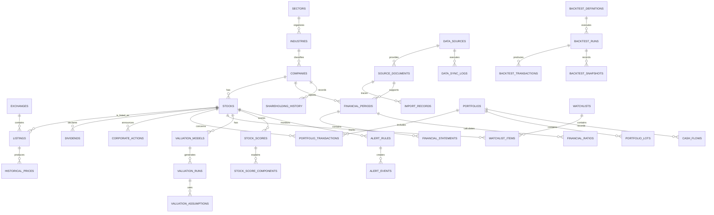

# Database Design

## Entity relationship diagram

## Core conventions

- Monetary and ratio values use `DECIMAL`, not floating point.
- Dates distinguish announcement date, period end, reporting date, effective date, and data-as-of time.
- Currency and units are mandatory for financial values.
- Imported documents and rows retain their original representation and checksum.
- Corrections create dated new snapshots or explicit correction records; they do not silently rewrite audit history.
- Soft deletion is used for user-created configuration. Audit records are append-only.

## Tables

### Reference tables

#### exchanges

- id
- code
- name
- country
- timezone
- created_at
- updated_at

Unique code is required.

#### sectors and industries

- id
- name
- parent sector ID where applicable
- source
- effective_from
- effective_to
- created_at
- updated_at

Classification changes are temporal to support historical analysis.

#### companies

- id
- canonical name
- isin
- legal identity identifier
- incorporation country
- website
- business description
- created_at
- updated_at

ISIN is nullable only while records are awaiting verification. Unverified or duplicate identities must not be merged automatically.

#### stocks

- id
- company_id
- common stock identity
- created_at
- updated_at

#### listings

- id
- stock_id
- exchange_id
- symbol
- listing_status
- listed_from
- delisted_at
- created_at
- updated_at

Unique exchange/symbol/effective-period constraints prevent ambiguity.

### Market tables

#### historical_prices

- id
- listing_id
- trading_date
- frequency
- open/high/low/close
- adjusted_close
- volume
- currency
- corporate_action_adjustment_status
- source_id
- source_timestamp
- ingested_at

Natural key: listing, trading date, frequency, and source. Adjusted and unadjusted prices remain separate.

### Fundamental tables

#### financial_periods

- id
- company_id
- period_end
- period_type (annual or quarterly)
- fiscal_year
- basis (standalone or consolidated)
- currency
- unit
- reporting_status
- amendment status
- source_document_id
- reported_at
- ingested_at

#### financial_statements

- id
- financial_period_id
- statement_type
- line_item_code
- reported_value
- unit
- display_sequence
- source_row_reference
- is_estimated

“Is estimated” must only be true for separately identified estimates; reported source values remain false.

#### financial_ratios

- id
- company_id
- period_id
- ratio_code
- reported_or_calculated
- value
- calculation_method_version
- input_snapshot_id
- calculated_at

Missing inputs produce no value and a reason code.

#### shareholding_history

- id
- company_id
- period_end
- holder_category
- holder_name or category key
- percentage
- source_document_id
- reported_at

#### dividends

- id
- stock_id
- announcement_date
- record_date
- ex_dividend_date
- payment_date
- dividend_per_share
- type
- status
- source_document_id

#### corporate_actions

- id
- stock_id
- action_type
- announcement_date
- ex_date
- effective_date
- ratio or new and old face value
- status
- source_document_id

### Provenance and synchronization

#### data_sources

- id
- code
- name
- provider_type
- official_status
- licensing_reference
- enabled
- base_url or package identity
- terms_reviewed_at
- terms_reviewed_by

Provider “official_status” can be official, licensed, manual, or disabled. It must never be asserted from package availability alone.

#### data_sync_logs

- id
- source_id
- job_type
- start/end time
- status
- source_timestamp
- row counts
- request_count
- warnings
- error_code
- error_message

#### source_documents

- id
- source_id
- document_type
- external URL or file key
- publication timestamp
- retrieved timestamp
- checksum
- parser version
- retention status

#### import_records

- id
- source_document_id or manual
- import_type
- mapping version
- validation_status
- row counts
- rejected-row details
- imported_by
- imported_at

### Portfolio tables

#### portfolios

- id
- name
- base_currency
- lot_matching_policy
- benchmark_listing_id
- created_at
- updated_at

#### portfolio_transactions

- id
- portfolio_id
- stock_id
- transaction_type
- trade_date
- settlement_date
- quantity
- price
- currency
- brokerage
- taxes
- other_charges
- external reference
- created_at

#### portfolio_lots

- id
- portfolio_id
- stock_id
- opening transaction id
- quantity
- cost basis
- acquired date
- closing status

Lot matching follows an explicit user-selected policy. The initial implementation should support FIFO and may later support average cost, with policy disclosed.

#### cash_flows

- id
- portfolio_id
- stock_id nullable
- cash_flow_type
- event_date
- amount
- currency
- dividend or tax detail
- source transaction id

#### watchlists

- id
- name
- created_at
- updated_at

#### watchlist_items

- id
- watchlist_id
- stock_id
- target valuation or price nullable
- note
- added_at

### Valuation and scoring

#### valuation_models

- id
- stock_id
- model_name
- model_type
- model_version
- created_by
- active
- created_at

#### valuation_runs

- id
- model_id
- run_at
- market_price snapshot
- intrinsic value
- margin of safety
- data_as_of
- input_snapshot_id
- method_version
- bear/base/bull values

#### valuation_assumptions

- id
- valuation_run_id
- assumption_code
- value
- unit
- source or manual
- rationale

#### stock_scores

- id
- stock_id
- as_of_date
- overall_score
- rank
- scoring_model_version
- data_quality_status
- complete critical-data flag
- calculated_at

#### stock_score_components

- id
- stock_score_id
- category
- raw score
- weight
- weighted score
- missing factor list
- explanation

### Alerts and backtesting

#### alert_rules

- id
- stock_id nullable
- portfolio_id nullable
- rule_type
- threshold values
- comparison
- enabled
- source
- created_at
- updated_at

#### alert_events

- id
- alert_rule_id
- triggered_at
- observed_at
- signal_kind (verified event or calculated signal)
- value
- source ids
- acknowledged_at

#### backtest_definitions

- id
- name
- start/end date
- rebalance schedule
- universe rule
- benchmark listing
- transaction cost assumptions
- scoring or screen definition

#### backtest_runs

- id
- definition_id
- method version
- status
- start/end time
- missing/unavailable data handling
- result summary

#### backtest_transactions

- id
- backtest_run_id
- trade date
- stock_id
- side
- quantity
- price
- cost

#### backtest_snapshots

- id
- backtest_run_id
- snapshot_date
- invested value
- market value
- cash
- benchmark value
- metrics snapshot

## Required indexes

- listing exchange/symbol and active status.
- price listing/trading date/frequency.
- financial period company/period end/basis/type.
- statement period/statement type/line item.
- ratio company/ratio code/period end.
- transaction portfolio/trade date.
- cash flow portfolio/event date.
- score stock/as-of date/category.
- alert rule enabled/type/stock.
- backtest snapshot run/date.
