# Phase and Task Progress Tracker

## Status values

- **Not started:** no implementation or review has begun.
- **Ready:** dependencies are satisfied and work may begin.
- **In progress:** assigned owner is actively implementing.
- **Blocked:** work has a missing decision or dependency.
- **Review:** implementation is complete but pending review.
- **Complete:** implementation, tests, documentation, and acceptance are complete.

## Current overall status

| Item | Status | Owner | Evidence |
|---|---|---|---|
| Repository and architecture documentation | Complete | Copilot | Root README and docs |
| Git, Copilot, Codex, and Cursor ignore files | Complete | Copilot | Ignore files |
| Phase 1 implementation | Not started | Shared, Copilot lead | Awaiting explicit approval |
| Phase 2 implementation | Not started | Copilot + Codex | After Phase 1 |
| Phase 3 implementation | Blocked on provider terms | Copilot lead | Provider license confirmation required |
| Phase 4 implementation | Not started | Shared | After Phase 3 |
| Phase 5 implementation | Not started | Shared | After Phase 4 |
| Phase 6 implementation | Not started | Copilot lead | After Phase 5 |
| Phase 7 implementation | Not started | Copilot lead | After Phase 6 |
| Phase 8 implementation | Not started | Shared | After Phase 7 |
| Phase 9 implementation | Not started | Shared | After Phase 8 |
| Phase 10 implementation | Not started | Copilot lead | After Phase 9 |

## Phase tracker

| Phase | Scope | Status | Primary owner | Reviewer | Approval |
|---|---|---|---|---|---|
| 1 | Architecture and repository setup | Ready only after approval | Copilot | Codex + Product owner | Pending |
| 2 | Database and NSE 500 universe | Not started | Copilot | Codex + Product owner | Pending |
| 3 | Permitted data-source adapters | Blocked on licensing | Copilot | Codex + Product owner | Pending |
| 4 | Fundamental screener | Not started | Codex UI, Copilot API | Both | Pending |
| 5 | Company analysis | Not started | Codex UI, Copilot API | Both | Pending |
| 6 | Intrinsic value calculator | Not started | Copilot | Codex + Product owner | Pending |
| 7 | Stock ranking engine | Not started | Copilot | Codex + Product owner | Pending |
| 8 | Portfolio management | Not started | Copilot API, Codex UI | Both | Pending |
| 9 | Dashboard and alerts | Not started | Codex UI, Copilot API | Both | Pending |
| 10 | Historical backtesting | Not started | Copilot | Codex + Product owner | Pending |

## Phase 1 task template

Copy this table and update it for each implementation phase.

| ID | Task | Owner | Status | Files | Tests | Dependency | Reviewer |
|---|---|---|---|---|---|---|---|
| P1-01 | Create workspace structure | Copilot | Not started | TBD at approval | TBD | Phase 1 approval | Codex |
| P1-02 | Scaffold NestJS API | Copilot | Not started | TBD | API health test | P1-01 | Codex |
| P1-03 | Scaffold Angular application | Codex | Not started | TBD | Frontend build test | P1-01 | Copilot |
| P1-04 | Scaffold Python service | Copilot | Not started | TBD | Python unit setup | P1-01 | Codex |
| P1-05 | Add Prisma baseline | Copilot | Not started | TBD | Migration test | P1-01 | Codex |
| P1-06 | Add Docker Compose | Codex | Not started | TBD | Local startup test | P1-02 to P1-05 | Copilot |
| P1-07 | Document setup commands | Codex | Not started | TBD | Link and command validation | P1-01 to P1-06 | Product owner |

Do not mark P1 tasks ready before the product owner approves Phase 1.

## Phase dependencies

```mermaid
flowchart LR
    P1[Phase 1 Architecture] --> P2[Phase 2 Database and Universe]
    P2 --> P3[Phase 3 Data Adapters]
    P3 --> P4[Phase 4 Screener]
    P4 --> P5[Phase 5 Company Analysis]
    P5 --> P6[Phase 6 Valuation]
    P6 --> P7[Phase 7 Ranking]
    P7 --> P8[Phase 8 Portfolio]
    P8 --> P9[Phase 9 Dashboard and Alerts]
    P9 --> P10[Phase 10 Backtesting]
```



## Blockers and decisions

| ID | Topic | Blocker or decision | Owner | Status | Resolution |
|---|---|---|---|---|---|
| B-001 | Groww official integration | Confirm official permitted data access and terms | Product owner | Open | No live Groww integration |
| B-002 | NSE/BSE access | Confirm data feed, history, retention, and display terms | Product owner | Open | No live ingestion |
| B-003 | Yahoo access | Confirm whether an expressly permitted integration exists | Product owner | Open | Adapter disabled |
| D-001 | Phase 1 approval | Begin repository implementation | Product owner | Pending | Explicit approval required |
| D-002 | Python/TypeScript API boundary | Confirm synchronous HTTP or task queue | Copilot | Deferred to Phase 1 | ADR required |
| D-003 | Portfolio cost basis policy | Choose initial lot-matching policy | Product owner | Pending | FIFO recommended |

## Decision log

Record decisions here for quick visibility and link to the corresponding ADR.

| Date | Decision | Owner | Linked ADR | Effect |
|---|---|---|---|---|
| 2026-11-18 | Angular, NestJS, Python, MySQL, and Docker | Product team | ADR 0001 | Approved proposed stack |
| 2026-11-18 | Reported, derived, and assumed values remain separate | Product team | ADR 0002 | Required for all analysis |
| 2026-11-18 | Groww adapter disabled until official terms are confirmed | Product team | ADR 0003 | No live Groww integration |
| 2026-11-18 | Decimal and explicit calculation boundary | Product team | ADR 0004 | Required for financial values |
| 2026-11-18 | Local-only deployment baseline | Product team | ADR 0005 | No public exposure by default |
| 2026-11-18 | Point-in-time backtesting | Product team | ADR 0006 | Bias controls required |

## Work-session handoff template

```text
Date:
Phase:
Completed:
In progress:
Blocked:
Next task:
Files changed:
Tests run:
Documentation updated:
Reviewer:
Product-owner approval needed:
```

## Progress update rules

- Update status the same day work changes.
- Link each task to the branch or change where practical.
- Record test evidence, not only “tests pass.”
- Mention missing data or licensing blockers.
- Do not mark tasks complete on implementation alone.
- Documentation and test updates are part of task completion.
