# Phase and Task Progress Tracker

## Status values

- **Not started:** no implementation or review has begun.
- **Ready:** dependencies are satisfied and work may begin.
- **In progress:** assigned owner is actively implementing.
- **Blocked:** work has a missing decision or dependency.
- **Review:** implementation is complete but pending review.
- **Complete:** implementation, tests, documentation, and acceptance are complete.

## Current overall status

| Item | Status | Owner | Evidence |
|---|---|---|---|
| Repository and architecture documentation | Complete | Copilot | Root README and docs |
| Git, Copilot, Codex, and Cursor ignore files | Complete | Copilot | Ignore files |
| Documentation review corrections | Complete | Codex | Roadmap, domain and calculation policies, API contract, collaboration guide, and tracker updated; source text verified as UTF-8 |
| Phase 1 implementation | Complete | Shared, Copilot lead | P1-01 through P1-07 meet their acceptance criteria and have been reviewed by Codex; product owner authorized closeout |
| Phase 2 implementation | Not started | Copilot + Codex | After Phase 1 |
| Phase 3 implementation | Not started; live adapters gated on provider terms | Copilot lead | Manual/import path can proceed after Phase 2 and Phase 3 approval; each live adapter requires documented authorization |
| Phase 4 implementation | Not started | Shared | After Phase 3 |
| Phase 5 implementation | Not started | Shared | After Phase 4 |
| Phase 6 implementation | Not started | Copilot lead | After Phase 5 |
| Phase 7 implementation | Not started | Copilot lead | After Phase 6 |
| Phase 8 implementation | Not started | Shared | After Phase 7 |
| Phase 9 implementation | Not started | Shared | After Phase 8 |
| Phase 10 implementation | Not started | Copilot lead | After Phase 9 |

## Phase tracker

| Phase | Scope | Status | Primary owner | Reviewer | Approval |
|---|---|---|---|---|---|
| 1 | Architecture and repository setup | Complete | Copilot | Codex + Product owner | Accepted by product owner on 2026-11-19; implementation approved on 2026-11-18 |
| 2 | Database and NSE 500 universe from user-supplied or otherwise permitted constituents | Not started | Copilot | Codex + Product owner | Pending |
| 3 | Import and provider adapter baseline; live integrations individually gated on terms | Not started | Copilot | Codex + Product owner | Pending |
| 4 | Fundamental screener | Not started | Codex UI, Copilot API | Both | Pending |
| 5 | Company analysis | Not started | Codex UI, Copilot API | Both | Pending |
| 6 | Intrinsic value calculator | Not started | Copilot | Codex + Product owner | Pending |
| 7 | Stock ranking engine | Not started | Copilot | Codex + Product owner | Pending |
| 8 | Portfolio management | Not started | Copilot API, Codex UI | Both | Pending |
| 9 | Dashboard and alerts | Not started | Codex UI, Copilot API | Both | Pending |
| 10 | Historical backtesting | Not started | Copilot | Codex + Product owner | Pending |

## Phase 1 task template

Copy this table and update it for each implementation phase.

| ID | Task | Owner | Status | Files | Acceptance criteria | Test expectations | Dependency | Reviewer |
|---|---|---|---|---|---|---|---|---|
| P1-01 | Create workspace structure | Copilot | Complete | Root `package.json`; `apps/`, `services/`, `prisma/`, `docs/`; tests are colocated with their modules | npm workspace exists and module boundaries are documented | `npm install`; verify workspace scripts | Phase 1 approval | Codex |
| P1-02 | Scaffold NestJS API | Copilot | Complete | `apps/api/**` | API starts locally and exposes `/api/v1/health` without external data | `npm run api:build`; `npm run test:api`; HTTP health check | P1-01 | Codex |
| P1-03 | Scaffold Angular application | Codex | Complete | `apps/web/**` | Strict Angular scaffold builds, displays no financial data, checks the API health endpoint, and has a documented local start command | `npm run web:build`; `npm run web:test`; `npm run web:lint`; start dev server and request its local page | P1-01 | Codex |
| P1-04 | Scaffold Python service | Copilot | Complete | `services/quant/**` | Python service environment and calculation test setup are documented | `npm run test:quant` | P1-01 | Codex |
| P1-05 | Add Prisma baseline | Copilot | Complete | `prisma/schema.prisma`, `prisma/migrations/**` | Baseline schema migrates against the local database | `npm run db:validate`; apply migration to local MySQL | P1-01 | Codex |
| P1-06 | Add Docker Compose | Codex | Complete | `docker-compose.yml`, `docker/**`, `.dockerignore`, `.env.example` | Services start healthy with host ports loopback-only and quant private | `docker compose config --quiet`; build/start stack and verify MySQL, API, web, and quant health | P1-02 to P1-05 | Codex |
| P1-07 | Document setup commands | Codex | Complete | `README.md`, `docs/09-development-standards.md` | Install, migration, startup, test, lint, backup, and restore commands are documented and consistent with the repo | Verify links and available commands; exercise backup/restore on disposable local data | P1-01 to P1-06 | Codex |

P1 tasks may be marked ready after product-owner approval; Phase 1 was approved on 2026-11-18.

### Phase 1 implementation evidence

- `npm ci` completed. `npm audit --omit=dev` reported zero production advisories; the full audit's 19 moderate development-tool advisories are tracked in D-005.
- `npm run api:build` passed; `npm run test:api` passed (1 test).
- `GET http://127.0.0.1:3000/api/v1/health` returned `{"status":"ok"}`.
- `python -m pip install -e "services/quant[dev]"` completed; `npm run test:quant` passed (1 test), and `GET http://127.0.0.1:8000/health` returned `{"status":"ok"}`.
- `npm run db:validate` and `npm run db:generate` passed. The baseline migration was applied to local MySQL on 2026-11-19; `prisma migrate status` reports the database is up to date.
- The product owner selected synchronous private HTTP for NestJS-to-Python communication; see ADR 0007. Calculation endpoints are not implemented yet.
- 2026-11-19: Angular scaffold build and lint passed; its Vitest suite passed (1 test), and the local dev server page returned HTTP 200. The UI displays no financial values.
- 2026-11-19: Built API started successfully with `npm run api:start`; the Angular dev proxy returned `{"status":"ok"}` from `/api/v1/health`. `npm run api:start:dev` could not start in this environment because Node.js `os.userInfo()` returned `uv_os_get_passwd` / `ENOMEM` under `tsx watch`.
- 2026-11-19: `npm run test:api` passed (1 test); `npm run test:quant -- -p no:cacheprovider` passed (1 test); `npm run db:validate` and `npm run db:generate` passed.
- 2026-11-19: `docker compose config` passed and all published ports resolve to `127.0.0.1`; quant has no published port. The initial runtime attempt was blocked by Docker Desktop connectivity.
- 2026-11-19: After setting `MYSQL_HOST_PORT=3307` and matching the host-run `DATABASE_URL` port in `.env`, MySQL started healthy on `127.0.0.1:3307`. API, web, and quant are healthy; API health returned `{"status":"ok"}` and web returned HTTP 200. Prisma applied `20261118230000_init`, and `prisma migrate status` reports the database is up to date.
- 2026-11-19: Exercised the documented MySQL dump/copy/restore flow against a disposable database. After changing its probe row, restoring the backup returned the original value; the disposable database and temporary dump files were removed. The configured application database was not modified.
- 2026-11-19: Verified the stack from Ubuntu 24.04 on WSL2. Added `.nvmrc` and Linux setup instructions; Node 24 API/web builds, API/web tests, web lint, Prisma validation, and quant tests passed. Docker Compose services stayed healthy; Python venv setup required Ubuntu's `python3.12-venv` package.
- 2026-11-19: `npm audit --omit=dev` reported zero vulnerabilities. Full audit reports 19 moderate transitive development-tool advisories in the Angular CLI toolchain; the suggested automatic fix forces Angular CLI 22 and a major upgrade. No broad or breaking upgrade was applied.

## Team update and next plan

- **Environment:** Ubuntu 24.04 on WSL2 is now the development environment. The repository is in the Linux filesystem; `.nvmrc` selects Linux Node 24, and local quant development uses a Python virtual environment.
- **Verified:** Docker Compose configuration and all services are healthy; Prisma reports the database up to date; API health returned `{"status":"ok"}` and web returned HTTP 200. API/web builds and tests, web lint, Prisma validation/generation, quant tests, and disposable-database backup/restore passed.
- **Phase 1 closeout:** P1-01 through P1-07 are Complete after Codex review. The product owner authorized closeout; no implementation blocker remains.
- **Immediate next:** Prepare the Phase 2 task breakdown for the database/domain schema and NSE 500 constituent universe using user-supplied or otherwise permitted constituents. Include provenance, effective dates, constraints, and migration tests; obtain explicit product-owner approval before Phase 2 implementation.
- **Still gated:** Provider-specific work remains subject to B-001 through B-003. Those licensing decisions do not block Phase 2's permitted manual/import path.

### Reviewer assessment

Codex reviewed P1-01 through P1-07 against the listed criteria. API build/test, Angular build/test/lint, Prisma validation/generation/migration status, the quant test, Compose configuration and service health, and local Markdown links passed. Backup/restore had already passed against disposable data. The API returns `{"status":"ok"}` and the web page returns HTTP 200. No implementation blocker was found. The product owner authorized Phase 1 closeout. P1-07's restore instructions distinguish Prisma schema validation from checking database connectivity and migration state.

### Phase 1 scope that intentionally depends on later phases

| Phase 1 foundation | Intentionally deferred capability | Planned phase | Acceptance impact |
|---|---|---|---|
| P1-02 API health scaffold | Domain endpoints, imports, and persistence beyond health | Phases 2–3 | Not a Phase 1 blocker |
| P1-03 Angular scaffold | Universe and company workflows, then screener/research UI | Phases 2, 4–5 | No financial data is expected in Phase 1 |
| P1-04 Quant service and test setup | Financial calculation endpoints and methods | Phases 4, 6–10 | Health-only service is expected in Phase 1 |
| P1-05 Prisma baseline | Company, listing, financial, and other domain tables | Phase 2 onward | Initial `DataSource` table is the Phase 1 baseline |
| P1-06 Compose service topology | API-to-quant calculation calls | When calculation APIs are implemented | Private quant service with health check is expected now |

## Phase dependencies

```mermaid
flowchart LR
    P1[Phase 1 Architecture] --> P2[Phase 2 Database and Universe]
    P2 --> P3[Phase 3 Data Adapters]
    P3 --> P4[Phase 4 Screener]
    P4 --> P5[Phase 5 Company Analysis]
    P5 --> P6[Phase 6 Valuation]
    P6 --> P7[Phase 7 Ranking]
    P7 --> P8[Phase 8 Portfolio]
    P8 --> P9[Phase 9 Dashboard and Alerts]
    P9 --> P10[Phase 10 Backtesting]
```



## Blockers and decisions

| ID | Topic | Blocker or decision | Owner | Status | Resolution |
|---|---|---|---|---|---|
| B-001 | Groww official integration | Confirm official permitted data access and terms before any live integration | Product owner | Open | No live Groww integration; manual/import work is independent |
| B-002 | NSE/BSE access | Confirm data feed, history, retention, and display terms before live ingestion | Product owner | Open | Use user-supplied or otherwise permitted constituent/import files until resolved |
| B-003 | Yahoo access | Confirm whether an expressly permitted integration exists | Product owner | Open | Adapter disabled |
| B-004 | Local Docker engine | Docker runtime checks were blocked in the prior host context | Product owner | Resolved | Ubuntu 24.04 on WSL2 runs the Compose stack healthy; MySQL is reachable on `127.0.0.1:3307`, and Prisma reports the database up to date |
| D-001 | Phase 1 approval | Begin repository implementation | Product owner | Resolved | Product owner approved Phase 1 on 2026-11-18 |
| D-002 | Python/TypeScript API boundary | Confirm synchronous HTTP or task queue before service integration | Product owner with Copilot | Resolved | Product owner selected synchronous private HTTP; see ADR 0007 |
| D-003 | Portfolio cost basis policy | Choose initial lot-matching policy before portfolio implementation | Product owner | Pending | FIFO is documented as an option, not selected by this tracker |
| D-004 | Risk metric conventions | Define return type, observation frequency/window, annualization, missing-observation handling, and risk-free rate source before exposing volatility or Sharpe results | Product owner with Copilot | Pending | See calculation policy; no conventions are inferred here |
| D-005 | Angular development-tool advisories | Decide remediation for 19 moderate transitive dev-tool advisories before a major Angular CLI upgrade | Product owner with Codex | Pending | Production-only audit is clean; npm's suggested forced fix upgrades Angular CLI to 22. No forced upgrade applied |

## Decision log

Record decisions here for quick visibility and link to the corresponding ADR.

| Date | Decision | Owner | Linked ADR | Effect |
|---|---|---|---|---|
| 2026-11-18 | Angular, NestJS, Python, MySQL, and Docker | Product team | ADR 0001 | Approved proposed stack |
| 2026-11-18 | Reported, derived, and assumed values remain separate | Product team | ADR 0002 | Required for all analysis |
| 2026-11-18 | Groww adapter disabled until official terms are confirmed | Product team | ADR 0003 | No live Groww integration |
| 2026-11-18 | Decimal and explicit calculation boundary | Product team | ADR 0004 | Required for financial values |
| 2026-11-18 | Local-only deployment baseline | Product team | ADR 0005 | No public exposure by default |
| 2026-11-18 | Point-in-time backtesting | Product team | ADR 0006 | Bias controls required |
| 2026-11-18 | Documentation review updates | Codex | This tracker and linked docs | Manual/import work is separated from live-provider licensing gates; formula, ownership, and Phase 1 task details clarified |
| 2026-11-18 | Phase 1 implementation started | Product owner | This tracker | Product owner approved foundation work; provider integrations remain out of scope |
| 2026-11-18 | Python service boundary | Product owner | ADR 0007 | NestJS calls Python over private synchronous HTTP; no public quant endpoint or broker |
| 2026-11-19 | Phase 1 tasks P1-03, P1-06, and P1-07 | Codex | This tracker | Frontend scaffold is ready for review; Compose runtime, migration, and disposable-database backup/restore are verified |
| 2026-11-19 | WSL2 environment and Phase 1 handoff | Copilot | This tracker | Ubuntu/WSL2 runtime is verified; Phase 1 is ready for review, with Phase 2 planning to follow product-owner acceptance |
| 2026-11-19 | Phase 1 Codex review and closeout | Codex | This tracker | P1-01 through P1-07 meet their acceptance criteria; product owner accepted Phase 1 on 2026-11-19. Phase 2 implementation still requires explicit approval |

## Work-session handoff template

```text
Date:
Phase:
Completed:
In progress:
Blocked:
Next task:
Files changed:
Tests run:
Documentation updated:
Reviewer:
Product-owner approval needed:
```

## Progress update rules

- Update status the same day work changes.
- Link each task to the branch or change where practical.
- Record test evidence, not only “tests pass.”
- Mention missing data or licensing blockers.
- Do not mark tasks complete on implementation alone.
- Documentation and test updates are part of task completion.
